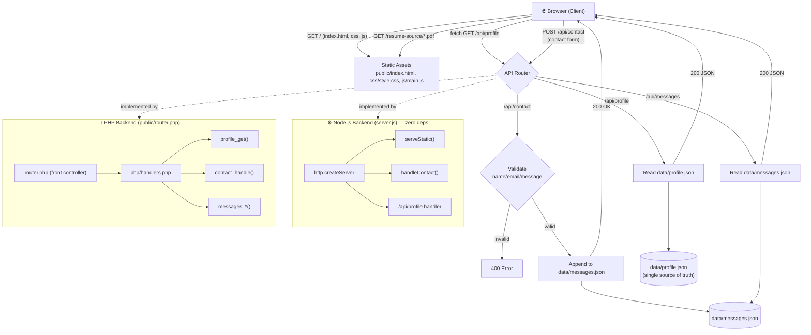

# Portfolio — Project Flowchart

## How the pieces connect

1. **Client** loads the single-page front-end and `main.js` renders every section
   from `data/profile.json` via `GET /api/profile` (falls back to embedded data
   if the API is unreachable, so the page still works opened directly).
2. The **contact form** POSTs to `/api/contact`; the client also retries
   `/api/contact.php`, so it works on either backend.
3. The **same API contract** is implemented twice:
   - `server.js` — Node built-in `http` (port 3000)
   - `public/router.php` + `php/handlers.php` — PHP built-in server (port 8000)
4. All content lives in **`data/profile.json`** — edit it once and both
   back-ends reflect the change with no rebuild.
