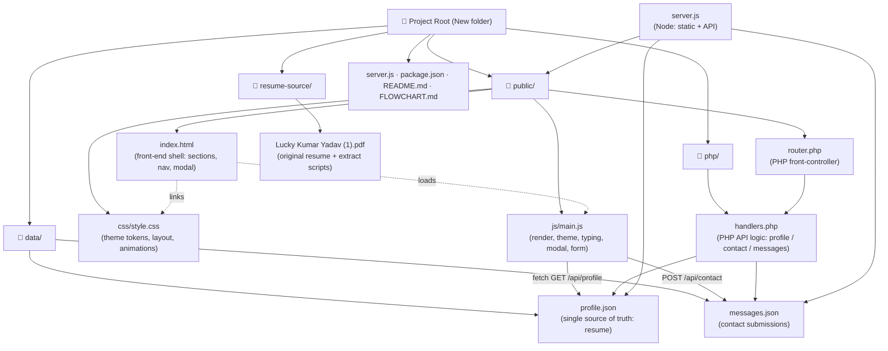

# Portfolio — Structural Flowchart

Shows the project's file/folder structure and how each component relates to the others.

## Component responsibilities

| Component | Role |
| --- | --- |
| `public/index.html` | Page skeleton: hero, about, skills, experience, projects, education, contact, modal |
| `public/css/style.css` | All styling: dark/light themes, responsive layout, animations |
| `public/js/main.js` | Renders data, theme toggle, typing effect, scroll reveal, project modal, contact form + validation |
| `public/router.php` | PHP built-in-server front controller (serves static + routes API) |
| `php/handlers.php` | PHP API logic shared by the router |
| `server.js` | Zero-dependency Node server (static + identical API) |
| `data/profile.json` | Resume content — edit here to update the whole site |
| `data/messages.json` | Stores contact-form submissions |
| `resume-source/` | Original PDF resume + extraction scripts (reference only) |
